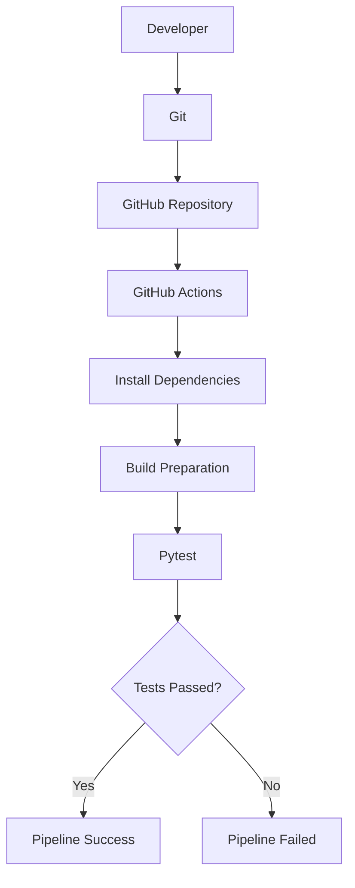

# Automated CI/CD Pipeline Using GitHub Actions, Python Flask and Pytest

## 1. Project Overview

This project demonstrates an automated Continuous Integration (CI) pipeline using Python Flask, Pytest, Git, GitHub and GitHub Actions.

Whenever a developer pushes code to the GitHub repository, the workflow automatically:
- Checks out source code.
- Sets up Python.
- Installs dependencies.
- Prepares the application.
- Executes automated tests.
- Reports pipeline success or failure.

## 2. Technologies Used

- Python 3.11
- Flask 3.1.2
- Pytest 8.4.2
- Git
- GitHub
- GitHub Actions

## 3. Project Structure

```text
CI-CD devops/
│
├── app.py
├── requirements.txt
├── Dockerfile
├── .dockerignore
├── .gitignore
├── README.md
├── PROJECT_REPORT.md
│
├── tests/
│   └── test_app.py
│
└── .github/
    └── workflows/
        └── ci-cd.yml
```

## 4. Application Features

- Flask Home Page
- Application Health Check API
- About API
- E-commerce Order Preview API
- Order amount calculation
- Invalid order validation
- Automated testing using Pytest

## 5. Installation

Clone the repository:

```powershell
git clone https://github.com/rahul-chowdhry/ci-cd-devops-project.git
cd ci-cd-devops-project
```

Create virtual environment:

```powershell
py -3.11 -m venv .venv
```

Install dependencies:

```powershell
.\.venv\Scripts\python.exe -m pip install -r requirements.txt
```

## 6. Run Application

```powershell
python app.py
```

Open:

http://127.0.0.1:5000/

## 7. API Endpoints

| Method | Endpoint | Purpose |
|--------|----------|---------|
| GET | / | Home Page |
| GET | /health | Health Check |
| GET | /about | Project Information |
| POST | /api/orders/preview | Order Calculation |

## 8. Run Automated Tests

```powershell
python -m pytest -v
```

The local test run reported 9 passed.

## 9. E-commerce API Example

Request:

```json
{
  "product": "Keyboard",
  "quantity": 2,
  "unit_price_paise": 150000
}
```

Expected total:

₹3,000

The API uses integer paise to calculate the amount.

## 10. CI/CD Pipeline

The GitHub Actions workflow is located at:

.github/workflows/ci-cd.yml

The workflow triggers automatically on:
- Push to main branch
- Pull request to main branch

Pipeline stages:

1. Checkout Source Code
2. Setup Python
3. Install Dependencies
4. Build Preparation
5. Run Pytest
6. Report Success or Failure

## 11. Architecture



## 12. Current Project Scope

Continuous Integration is implemented and verified.

Automatic deployment is not configured.

Docker files are included in the repository but Docker execution has been skipped and not verified.

## 13. GitHub Repository

https://github.com/rahul-chowdhry/ci-cd-devops-project

## 14. Conclusion

This project demonstrates how GitHub Actions automates application build preparation and testing whenever code changes are pushed to GitHub.

It reduces manual testing effort and helps developers identify errors early in the software development process.
